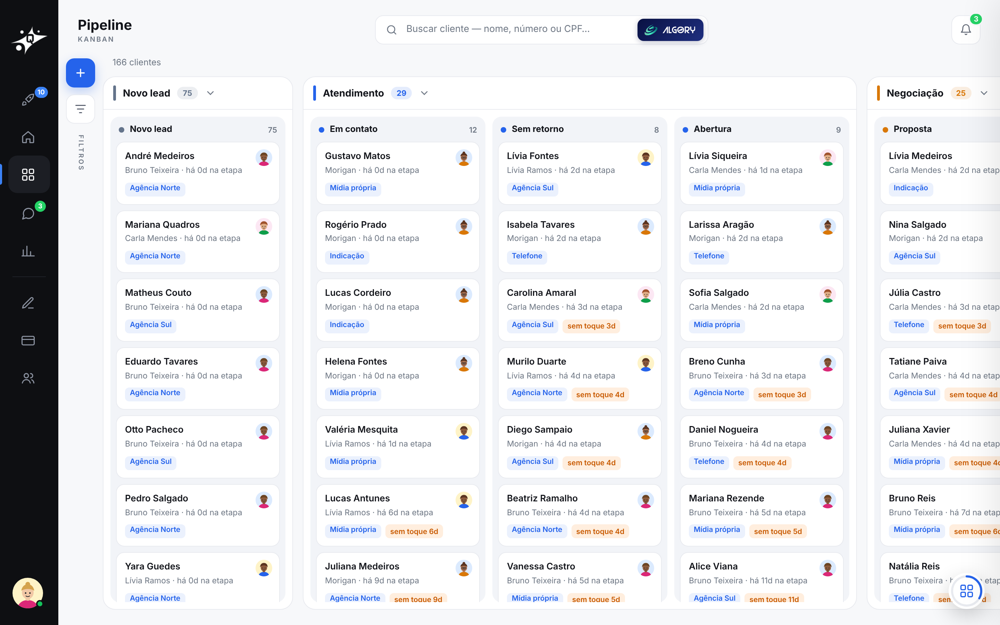

# Quasar · demo pública

O Quasar é o ERP comercial que eu desenvolvo com o Matheus Ventrici para captação e conversão de clientes. Ele cobre o caminho inteiro: o lead que chega pelo anúncio, a venda, o contrato assinado e o primeiro pagamento. Este repositório documenta a demonstração pública, que roda com dados fictícios e provedores simulados.

Demo: https://demoquasar.osmio.tech · Apresentação: https://demoquasar.osmio.tech/apresentacao

## Funcionalidades

- **Ficha do cliente dinâmica.** Tudo no Quasar parte dela: contrato, termo, cobrança, assinatura, mensagem e relatório usam os dados que estão na ficha. Nada é digitado duas vezes.
- **Geração de contrato dinâmica.** O contrato e o termo são montados no servidor a partir da ficha, em PDF e com versões.
- **Assinatura por API.** Envelopes, eventos e retorno por webhook assinado (Clicksign em produção).
- **Pagamentos por API.** Link, Pix, boleto e cartão parcelado, com recusa, troca de método e baixa por webhook (PayZen e Cora em produção).
- **Histórico de conversas pela API da Meta.** As conversas do WhatsApp Business ficam registradas na ficha, com janela de 24 h e modelos aprovados.
- **Estrutura pronta para API interna.** Os provedores são plugáveis: a mesma interface atende uma API externa ou um provedor interno. Na demo, a assinatura (FluxSign) e o pagamento (FluxPay) rodam dentro do próprio app, com os mesmos webhooks.
- **Pipeline com regras no servidor.** Kanban em 4 fases e 11 etapas, travas por etapa, distribuição por peso e listas de trabalho com objetivo.
- **Relatórios simples com assistente.** Financeiro, funil e time, com o Algory fazendo as contas sobre os mesmos filtros da tela.
- **Algory, agente interno.** Responde com os números de agora e leva até a ação, sempre como proposta que a pessoa confirma.

## As partes

| | Parte | |
|---|---|---|
| 1 | [Demo e missões](docs/01-demo/) | como entrar, papéis, as 10 missões, a apresentação |
| 2 | [Pipeline](docs/02-pipeline/) | kanban e travas, listas, distribuição |
| 3 | [Ficha do cliente](docs/03-ficha/) | OCR, documentos, assinatura, pagamento |
| 4 | [Contatos](docs/04-contatos/) | WhatsApp |
| 5 | [Home, Gestão e Relatórios](docs/05-home-gestao-relatorios/) | agenda, metas, ranking, financeiro, funil, time |
| 6 | [Algory](docs/06-algory/) | o agente interno: como decide, como aciona a tela, custos |
| 7 | [Integração com o Flux](docs/07-integracao-flux/) | eventos assinados entre comercial e operação |
| 8 | [Documentação técnica](docs/08-tecnico/) | arquitetura, por que cada ferramenta, dados, testes |
| 9 | [Segurança](docs/09-seguranca/) | revisão antes de abrir e publicação na VPS |

A origem do projeto e o que está em uso comercial estão no [CASE.md](CASE.md).

## Os outros projetos

O Quasar faz parte de um conjunto que eu mantenho na Osmio:

- **Flux** (https://demoflux.osmio.tech): gestor de processos. É a operação da mesma empresa fictícia (instalação, cobrança recorrente, retenção) e conversa com o Quasar por eventos assinados. Veja a [integração](docs/07-integracao-flux/).
- **Algory** (https://algory.osmio.tech): agente de IA que começou pelos relatórios e é produto próprio. Nasceu de um projeto de faculdade do Matheus, e eu coloquei para rodar. O agente que vive dentro do Quasar é o mesmo plano aplicado a um sistema interno. Veja [a origem e os planos](docs/06-algory/#origem).

## Como usar a demo

1. Abra https://demoquasar.osmio.tech no computador. No celular, ative "Versão para computador" no navegador.
2. Não há login. Você entra como Renata (supervisora) e pode trocar para Carla (consultora) ou Davi (dono) no perfil.
3. Siga as 10 missões da Boas-vindas ou pergunte ao Algory "Por onde eu começo?".
4. O que você fizer é real dentro da demo e volta ao estado inicial a cada hora.

| | |
|---|---|
| Real (código de produção) | pipeline, travas, distribuição, documentos, relatórios, auditoria, regras de cargo |
| Simulado | assinatura e pagamento, com os mesmos webhooks assinados da produção |
| Fora | telefonia e envio real de WhatsApp (a demo mostra o payload que iria para a API da Meta) |

## Uso de IA e custo

A demo é pública e a IA sai do meu bolso. Por isso o uso de tokens é tratado como gestão financeira:
- verba fixa de US$ 5 por mês;
- 30 perguntas por hora por visitante;
- modelos gratuitos como reserva;
- tudo o que o banco responde sozinho não passa pelo modelo.

Quando o limite acaba, o Algory continua respondendo, com menos recursos. Os detalhes estão em [Algory › Gestão dos tokens](docs/06-algory/#gestão-dos-tokens).

## Políticas

- **Licença:** todos os direitos reservados. O conteúdo pode ser lido para avaliação; uso, cópia ou reprodução precisam de autorização por escrito. Veja [LICENSE](LICENSE).
- **Dados:** tudo é fictício. Não coloque dados reais; o banco é refeito de hora em hora.
- **Segurança:** se achar algo, abra uma issue ou escreva para mail@osmio.tech. Não rode ferramenta de carga contra a demo: há limite por IP e a VPS é compartilhada.
- **Contribuições:** repositório de portfólio, sem pull requests. Sugestões por issue são bem-vindas.
- **Código-fonte:** não é publicado. Uma avaliação técnica do código pode ser combinada comigo.

## Stack

Python 3.12, FastAPI, PostgreSQL 16, WeasyPrint, HTML/CSS/JS sem framework, Docker rootless, nginx, Claude Haiku, Groq (gpt-oss) e Gemini no Algory, Playwright nos testes. O porquê de cada escolha está na [documentação técnica](docs/08-tecnico/#2-por-que-essas-ferramentas).

## Autores

Morigan Ventrici, autor, com Matheus Ventrici. Contato: mail@osmio.tech

© 2026 Morigan Ventrici e Matheus Ventrici. Todos os direitos reservados.
