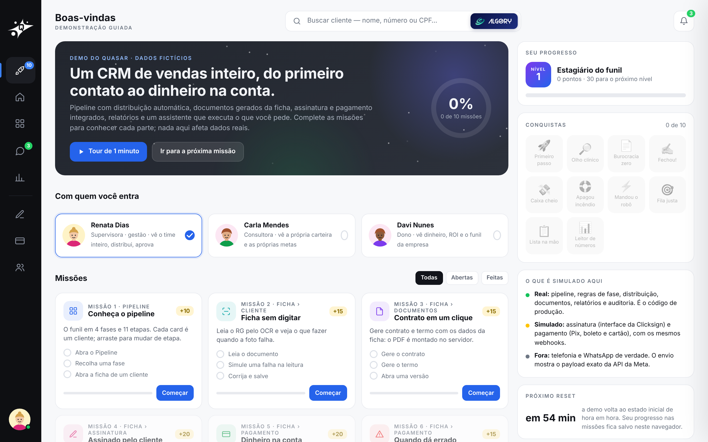
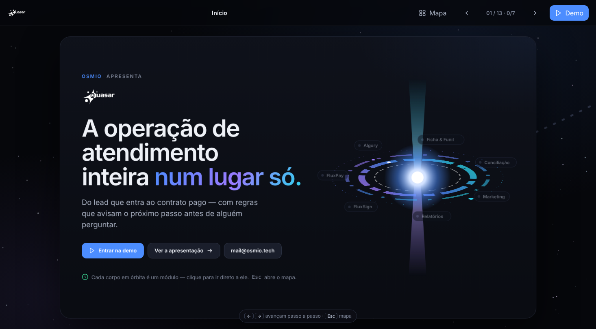
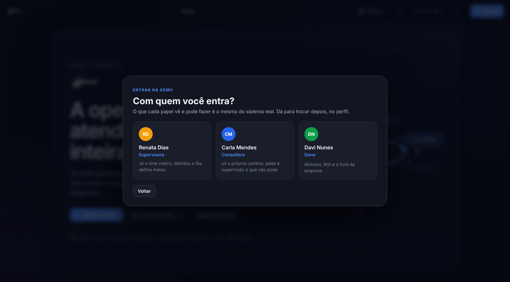
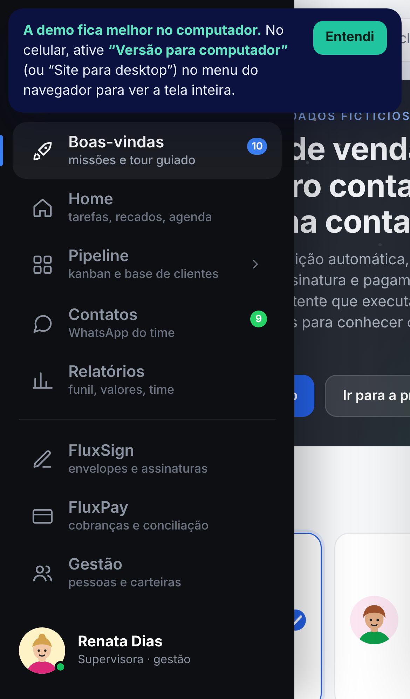

# 1 · Demo e missões

🔗 https://demoquasar.osmio.tech · [voltar ao início](../../README.md)

## Entrar

- **Sem login.** O visitante entra como **Renata Dias** (supervisora). No perfil, no canto inferior esquerdo, dá para trocar para:
  - **Carla Mendes** (consultora), que vê só a própria carteira;
  - **Davi Nunes** (dono), que vê dinheiro, ROI e o funil da empresa.
- **O banco volta ao começo a cada hora.** O progresso nas missões fica no navegador.
- **A demo foi feita para computador.** No celular aparece um aviso sugerindo "Versão para computador" no navegador.

## A empresa da demo

**Demo Corporation**, provedora de internet por fibra com cerca de 520 assinantes. Vende planos mensais, add-ons e instalação. O Quasar é o comercial dela: capta o lead, conduz a venda, assina o contrato e recebe o primeiro pagamento. O mesmo cenário é usado pelo **Flux**, o sistema de operação ([integração](../07-integracao-flux/)).

## As 10 missões

| # | Missão | Onde | O que você faz | Pontos |
|---|---|---|---|---|
| 1 | Conheça o pipeline | Pipeline | abra o Pipeline, recolha uma fase, abra a ficha de um cliente | 10 |
| 2 | Ficha sem digitar | Ficha › Cliente | leia o RG pelo OCR, simule uma falha na leitura, corrija e salve | 15 |
| 3 | Contrato em um clique | Ficha › Documentos | gere o contrato e o termo, abra uma versão | 15 |
| 4 | Assinado pelo cliente | Ficha › Assinatura | veja o convite, envie, assine como se fosse o cliente (o retorno vem por webhook) | 20 |
| 5 | Dinheiro na conta | Ficha › Pagamento | escolha os itens, gere em 2x ou mais no cartão, pague como cliente | 20 |
| 6 | Quando dá errado | Ficha › Pagamento | provoque uma recusa, cancele e troque o método, receba no Pix | 15 |
| 7 | Peça ao Algory | Algory | pergunte quantos leads estão na fila e confirme a distribuição | 20 |
| 8 | Distribua o aquecimento | Pipeline › Distribuição | monte a fila pelo peso, confira lead a lead e entregue | 20 |
| 9 | Lista com objetivo | Pipeline › Lista | abra uma lista do time, crie a sua com objetivo e prazo | 15 |
| 10 | Leia os números | Relatórios | abra o funil, veja os valores, compare o time | 10 |

As missões 3 a 6 dependem da anterior: não dá para assinar sem contrato nem cobrar sem assinatura. Se travar, pergunte ao Algory *"Como faço 'Dinheiro na conta'?"*. Ele leva até a primeira missão livre e aponta cada passo ([como o Algory aciona a tela](../06-algory/#como-o-algory-aciona-a-tela)).

## A apresentação

**https://demoquasar.osmio.tech/apresentacao**: 13 slides navegáveis, com mapa, sobre o problema, o fluxo, a conciliação, o kanban, o Algory e o plano de implantação por fases.

O botão **"Entrar na demo"** pergunta com qual papel você quer entrar. Você chega na Boas-vindas com esse papel, e o Algory abre perguntando por onde começar.

## No celular

