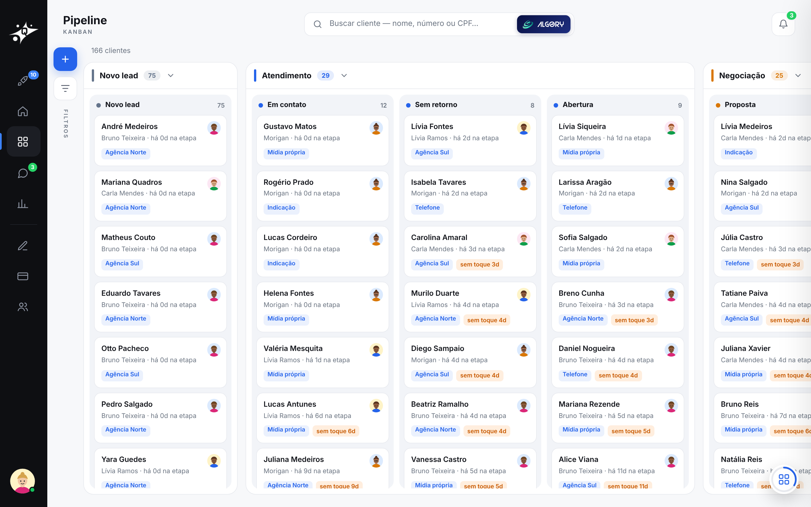
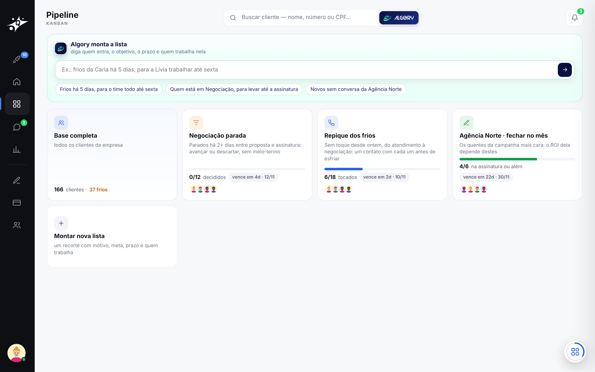
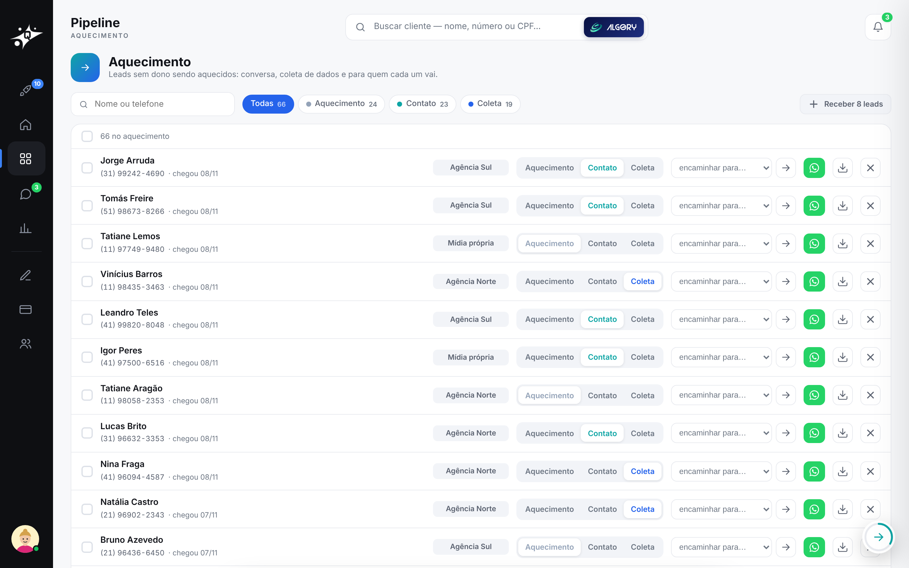

# 2 · Pipeline

[voltar ao início](../../README.md)

O funil inteiro numa tela, com as regras no servidor.

## Kanban

- **4 fases e 11 etapas:** Novo lead, Atendimento (Em contato, Sem retorno, Abertura), Negociação (Proposta…), Onboarding (Assinar contrato, Realizar pagamento, Pós-venda).
- **Mover é a mesma rota de produção.** Arrastar um card chama a mudança de etapa do Quasar, com as **travas**. Levar um lead de "Em contato" direto para "Assinatura" é recusado com o motivo ("preencha na ficha: banco do contrato"). Com a trava de fatos ligada, a ficha precisa ter também o fato: documento gerado, assinatura, pagamento.
- **Parados:** cada card mostra os dias sem toque; a partir de 3 dias, ele ganha o selo "sem toque".
- **Gatilhos:** quando o cliente responde no WhatsApp, o card anda sozinho para a etapa certa.

## Listas de trabalho

- Uma lista é um recorte da base com **objetivo** (tocar, responder, avançar…), **prazo** e **dono**.
- O **progresso é calculado pelo estado dos clientes**, não por marcação manual: um cliente tocado depois da criação da lista conta como feito.
- O Algory monta a lista a partir de um pedido em texto (*"os frios há 5 dias, para o time trabalhar até sexta"*) e mostra uma prévia antes de criar.

## Distribuição

- **Aquecimento:** os leads que chegam sem dono ficam aqui.
- **Fila por peso e crédito:** cada consultor tem um peso. Quem recebeu menos, proporcionalmente ao peso, recebe primeiro, e o crédito não zera a cada rodada.
- **Prévia lead a lead antes de entregar.** Distribuir é só da supervisão e do dono; o consultor recebe uma nota de cargo.
