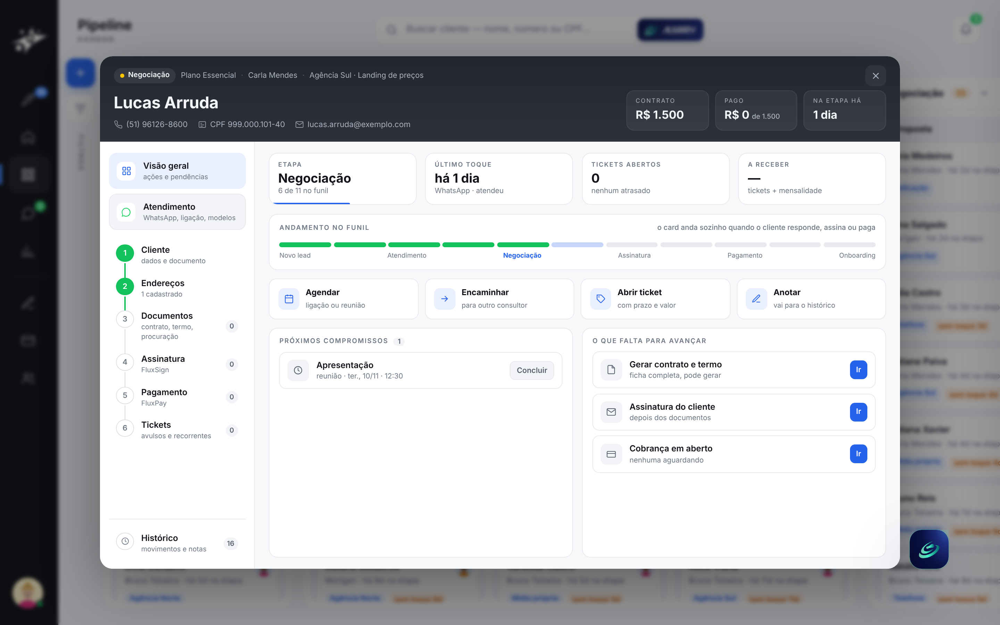
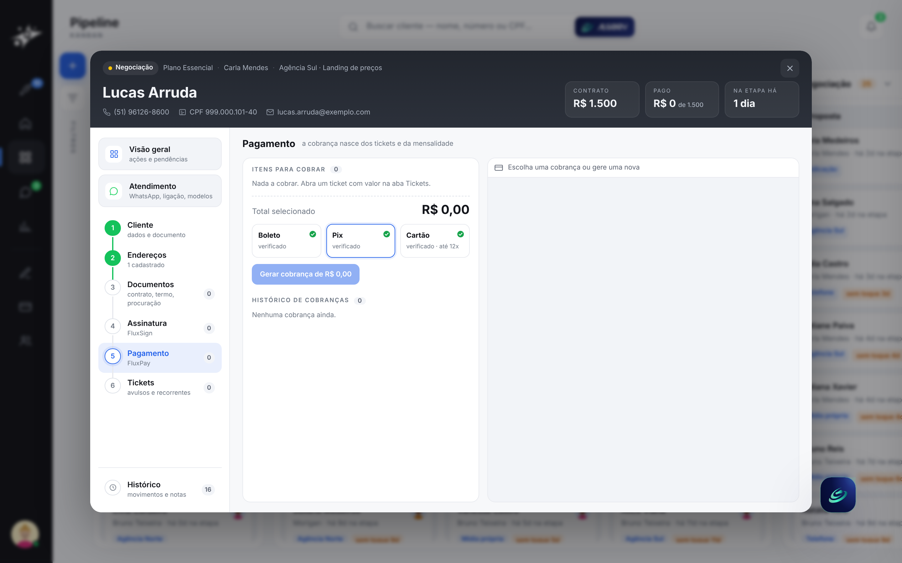
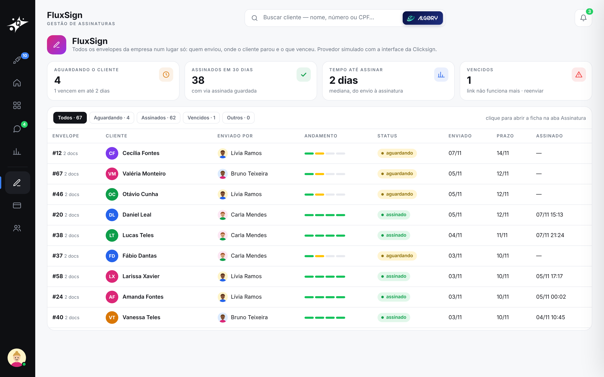
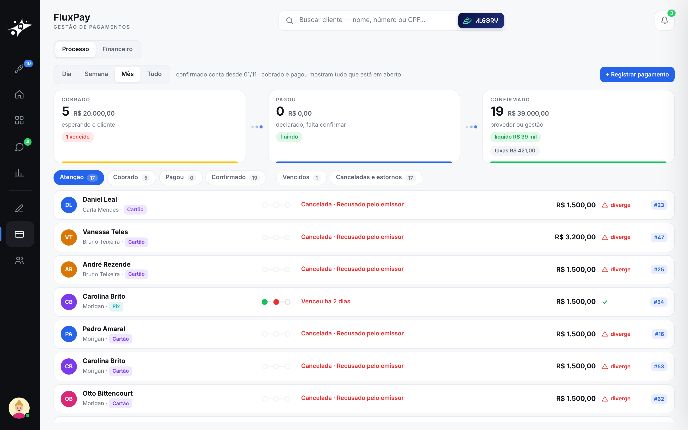

# 3 · Ficha do cliente

[voltar ao início](../../README.md)

Tudo sobre um cliente, em passos: Cliente › Endereços › Documentos › Assinatura › Pagamento › Tickets, com a Visão geral, o Atendimento e o Histórico ao lado.

## O ciclo

1. **Cliente (OCR):** lê o RG e preenche os campos. Na demo o OCR é simulado e não processa arquivo do visitante. Dá para simular uma falha de leitura e corrigir à mão.
2. **Documentos:** contrato e termo em **PDF gerados no servidor** (WeasyPrint) a partir dos dados da ficha, com versões.
3. **Assinatura (FluxSign):** cria o envelope e envia o convite. O visitante assina "como o cliente" no simulador, e o retorno chega por **webhook com assinatura HMAC**, como na produção (Clicksign).
4. **Pagamento (FluxPay):** escolha dos itens, Pix, boleto ou cartão parcelado. Pagar, recusar, cancelar e trocar o método. A baixa vem por webhook e o líquido é calculado depois da taxa.
5. **Tickets e histórico:** tickets com prazo e valor; trilha de auditoria de tudo o que mudou.

## FluxSign e FluxPay

As telas de gestão dos dois provedores:
- **FluxSign:** envelopes por estado, tempo até assinar e vencidos para reenviar.
- **FluxPay:** cobranças por estado (aberta, paga, recusada, vencida) e conciliação.

| FluxSign | FluxPay |
|---|---|
|  |  |

Na demo, os dois são simuladores que respondem pelos mesmos webhooks da produção (Clicksign, PayZen, Cora).
