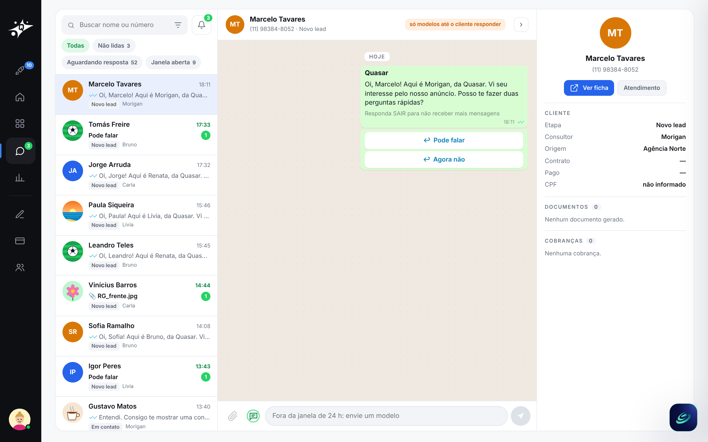

# 4 · Contatos

[voltar ao início](../../README.md)

O WhatsApp do time, com as regras da API oficial da Meta.

- **Conversas em aberto**, com filtros: não lidas, aguardando resposta, janela aberta.
- **Janela de 24 h:**
  - dentro dela, texto livre;
  - fora dela, só **modelos aprovados**, como exige a API do WhatsApp Business.
- **O envio mostra o payload exato** que iria para a API da Meta. Na demo, nada sai de verdade.
- **Uma conversa respondida faz o card andar** no kanban (gatilho de resposta).
- **Pelo Algory**, a pergunta *"Quantas conversas estão em aberto?"* termina em **Montar a lista** para o time responder.
