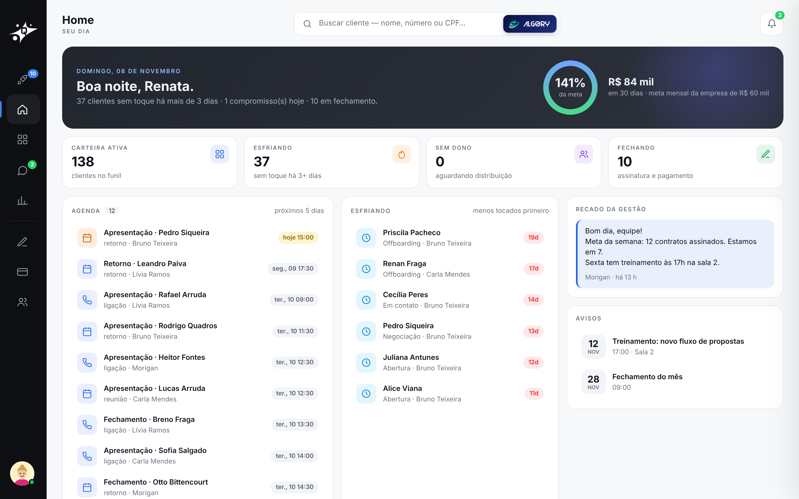
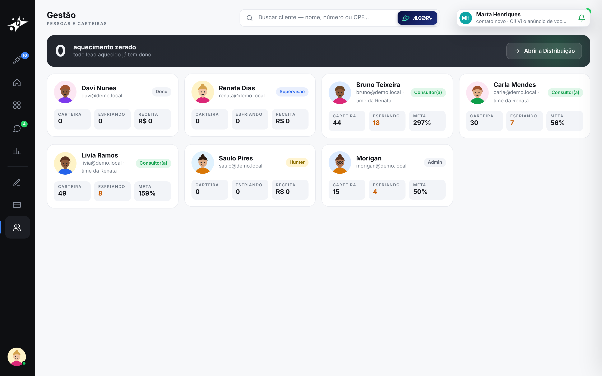
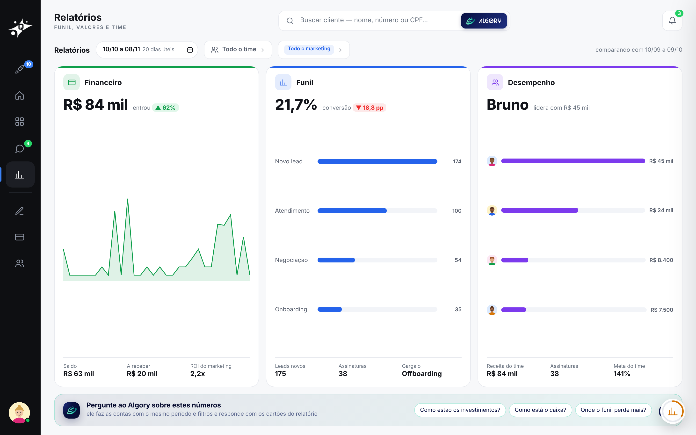

# 5 · Home, Gestão e Relatórios

[voltar ao início](../../README.md)

## Home

O dia de quem está logado:
- agenda dos próximos dias;
- carteira ativa;
- leads esfriando (sem toque há 3+ dias);
- sem dono;
- em fechamento;
- o anel da meta do mês;
- o recado da gestão.

Cada número muda com o papel: a Carla vê a carteira dela, e a Renata e o Davi veem o time.

## Gestão

Pessoas e carteiras: ranking, metas, carteira, esfriando e receita por pessoa.

## Relatórios

- **Três painéis ao vivo**, com período e filtros por time e por canal de marketing:
  - **financeiro:** entrou, saldo, a receber, ROI do marketing;
  - **funil:** conversão por etapa;
  - **desempenho do time.**
- **O Algory em tela cheia** faz as contas com o mesmo período e os mesmos filtros da tela ([Algory](../06-algory/)).
- **Regras de cargo:** a Carla vê o próprio recorte e não vê ROI nem investimento.
