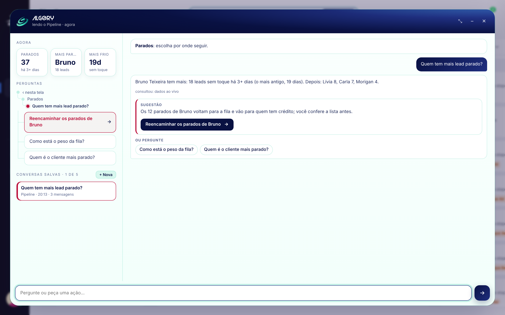
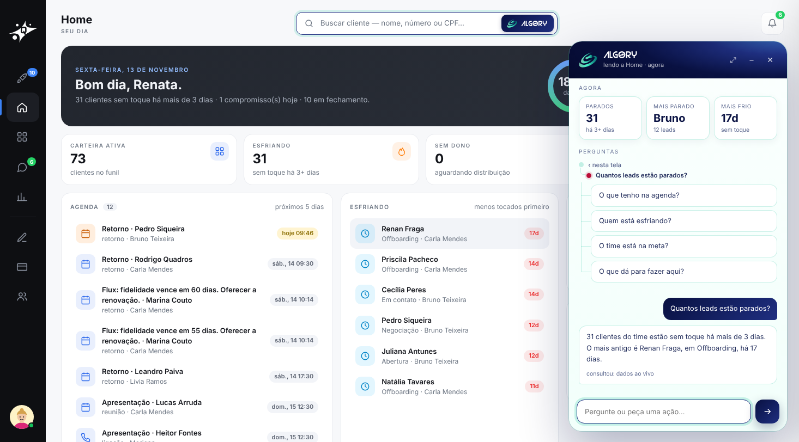
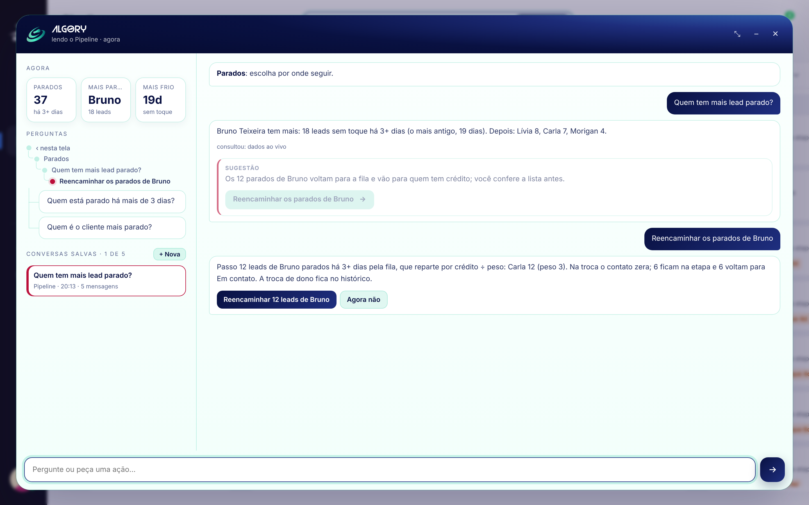
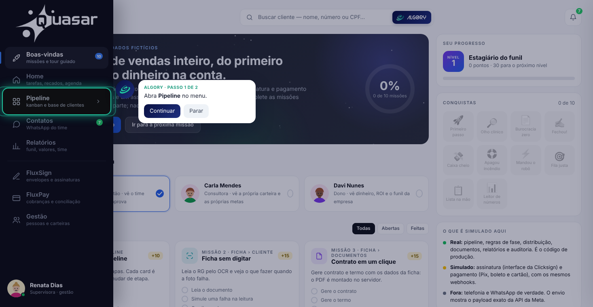
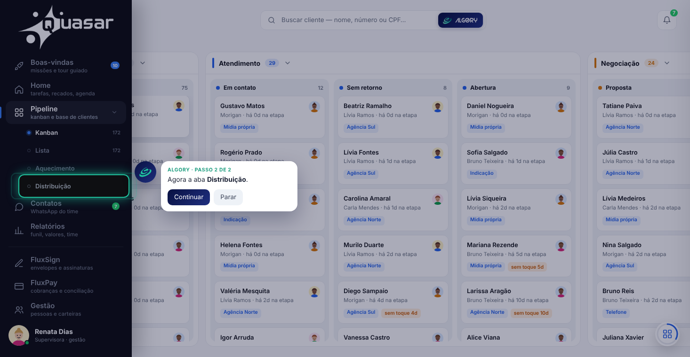
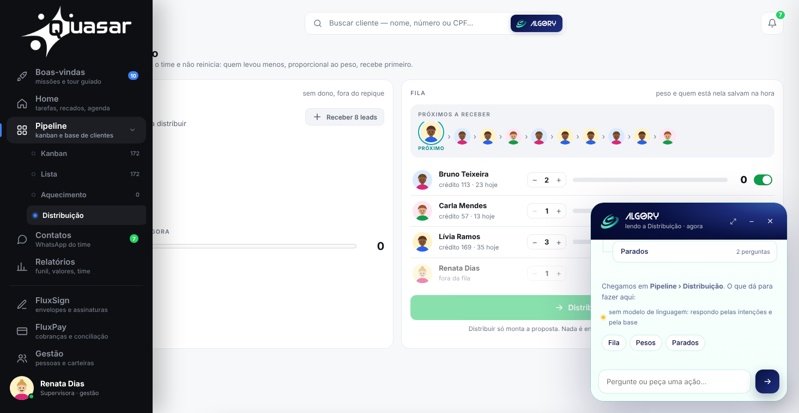
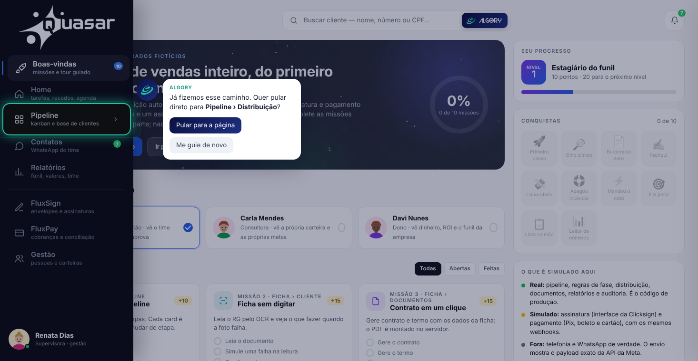
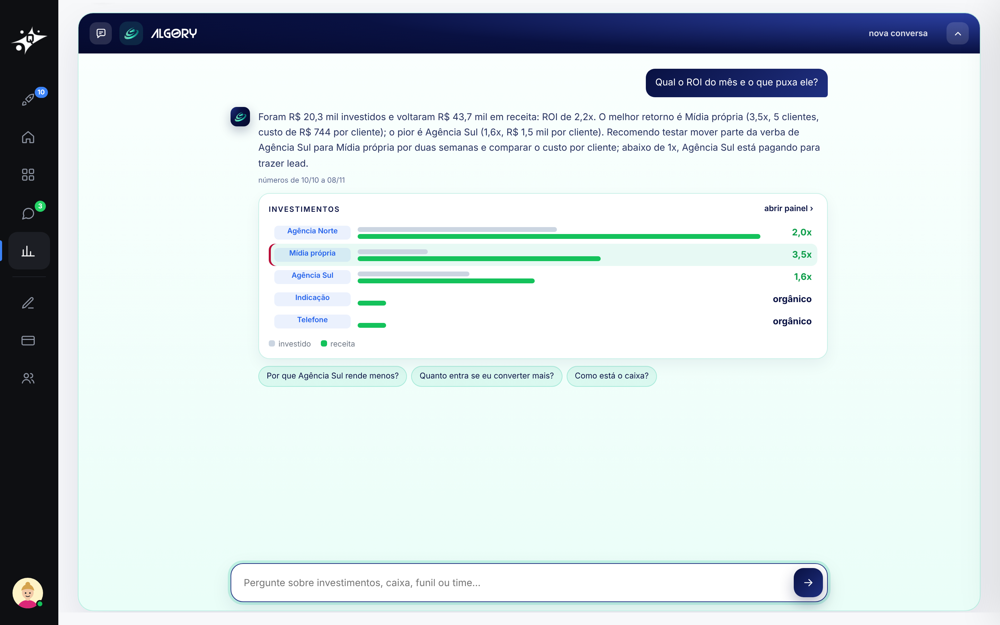
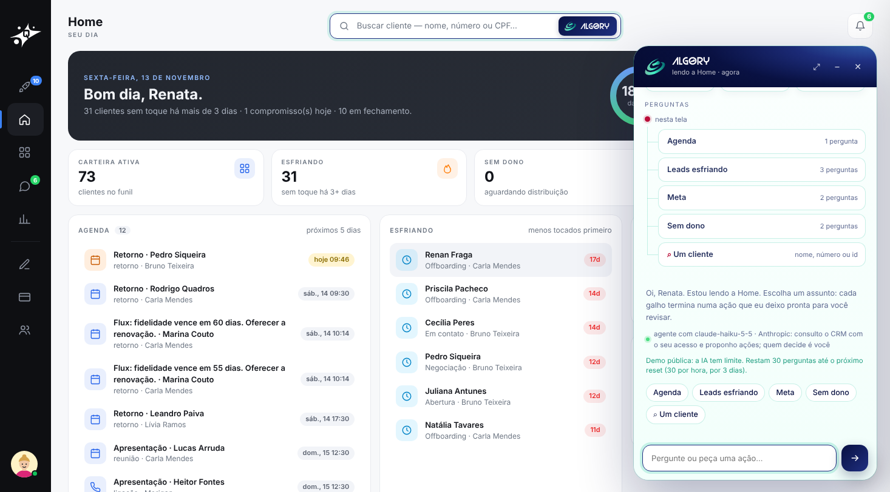

# 6 · Algory, o agente interno do Quasar

[voltar ao início](../../README.md)

O Algory vive dentro do Quasar. Ele lê o sistema com o acesso de quem pergunta, responde com os números de agora e leva até a ação. Toda ação sai como proposta que a pessoa revisa e confirma. Ele não executa nada sozinho.



## Origem

O Algory começou como um projeto de faculdade que o Matheus Ventrici sonhava em fazer. A ideia é dele. Decidimos juntos começar pelo **Algory agente de relatórios**, para testar na prática as ferramentas que um agente desses pode oferecer.

Eu tirei a ideia do papel em uma semana de programação e coloquei para rodar. Hoje ele é um produto próprio em https://algory.osmio.tech. Cobramos um valor de entrada porque a intenção é deixar a ferramenta com colegas, que vão usando, e amadurecer o Algory com eles.

No Quasar fiz dois acréscimos:
- **os gatilhos internos:** eventos do próprio sistema que o Algory observa e transforma em sugestão ou ação;
- **o Algory como agente interno:** em vez de um chat ao lado, um agente que usa as mesmas rotas, regras e permissões do sistema.

O projeto está em andamento, e a cada dia entra mais coisa.

## Para onde ele vai

Relatório foi só o começo. O plano é otimizar uma linha inteira de trabalho com um agente que assume o papel que faltar:
- analista;
- técnico;
- assistente de chat;
- atendente de loja por mensagem;
- financeiro;
- planner;
- projetista.

Os planos maiores:
- **Complementar ou substituir a função administrativa** em sistemas com gatilhos automáticos: o agente percebe o evento e já deixa a ação pronta, como faz aqui no Quasar.
- **Rodar na rede do cliente,** como agente interno, com um custo menor que o das APIs de modelo e voltado também para predições de mercado.
- **Levar IA a quem não usa IA:** o Algory entra nos sistemas que a pessoa já usa e a guia dentro dos próprios relatórios e dashboards, sem que ela precise saber escrever prompt.

A inspiração vem de produtos como a Minuta IA, que atendeu um nicho carente de tecnologia, com muitos profissionais que não usavam IA no trabalho. A estrutura é simples:
1. proteger os dados do cliente;
2. mandar para um motor;
3. processar o retorno;
4. devolver ao servidor do cliente.

Para nós, o Algory é o case que mostra a nossa capacidade de trabalhar com IA e de levar esse conhecimento técnico para quem não tem experiência com ela.

## Princípios

1. **Os números vêm do banco, não do modelo.** O modelo redige e escolhe ferramentas; contagem, valor e nome saem de consulta no servidor.
2. **O cargo vem da sessão.** Consultor vê a própria carteira. Ação que é da gestão volta como nota de cargo, sem botão. Nenhum texto do usuário muda isso.
3. **Toda ação é uma proposta.** O servidor monta uma prévia com um token; a ação só acontece no clique e pela mesma rota de produção.
4. **Cada caminho termina numa ação.** As perguntas de cada tela são organizadas por assunto, em árvore, e o fim de cada galho é uma ação pronta para revisar.

## Como ele decide

Cada pedido passa por esta ordem; o primeiro que resolver responde:

| | Caminho | Usa modelo |
|---|---|---|
| 1 | objetivo do fim do galho: monta a proposta direto | não |
| 2 | pergunta que o banco responde sozinho (parados, agenda, fila, pesos) | não |
| 3 | regra de cargo: consultor pedindo distribuir ou reencaminhar recebe a nota | não |
| 4 | cliente escolhido na busca: dossiê com etapa, conversa, documentos, assinatura, cobrança e o que falta | não |
| 5 | caso geral: intenção + agente com ferramentas + redes de segurança do servidor | sim |

Os caminhos 1 a 4 respondem em ~50 ms, não erram conta e não gastam token. O modelo só entra quando é preciso redigir ou escolher entre ferramentas.



## Como o Algory aciona a tela

O Algory não clica em nada por conta própria e não roda código na página. A resposta do servidor é estruturada, e a interface só interpreta campos conhecidos:

| Campo | O que a interface faz |
|---|---|
| `texto`, `cards` | escreve a resposta e os cartões de números |
| `confirmar`, `botao`, `previa` | monta o cartão de ação com a prévia; o clique devolve o token ao servidor |
| `nota` | mostra a nota de cargo (sem botão) |
| `ir` | leva até onde o resultado mora: lista, kanban, ficha, conversa ou tela |
| `objetivo`, `perguntas` | oferece o próximo passo da árvore |
| `dash` | abre o painel certo nos Relatórios |
| `tickets` | atualiza o contador da demo pública |

A confirmação é assim:

```
interface ──POST {confirmar: token}──▶ servidor
                                        ├─ confere o token (vale 15 min, é do mesmo usuário)
                                        ├─ confere cargo e carteira de novo
                                        ├─ executa pela rota de produção (com as travas de etapa)
                                        └─ devolve {texto, ir}
interface ◀── navega até o resultado (guia) e mostra o que mudou
```



O token guarda o que foi mostrado na prévia. Os ajustes que a pessoa faz no cartão só podem restringir:
- tirar leads da lista;
- mudar nome e prazo;
- escolher etapa ou pessoa entre as válidas;
- valores dentro dos limites.

**O guia de navegação** é montado na interface a partir de um destino (`{tela, aba}`). Ele vira a lista de cliques que a pessoa faria: o item do menu (`.it[data-tela]`) e depois a aba (`.sub[data-v]`). Em cada passo:
1. espera o alvo parar de se mover (a rolagem e a abertura do menu terminam);
2. desenha a silhueta sobre o retângulo do alvo;
3. posiciona a mini conversa do lado com mais espaço.

O clique da pessoa é observado em fase de captura, sem bloquear o clique original. "Continuar" chama o mesmo `click()` do elemento. Ao chegar, o painel volta ao modo de antes e lista os assuntos da página. A primeira vez em cada destino é sempre guiada. Da segunda em diante, ele pergunta se quer pular, e essa marca fica guardada no navegador.

| 1 · menu | 2 · aba | chegada |
|---|---|---|
|  |  |  |

**A ficha** abre num iframe da mesma origem. O Algory aponta elementos lá dentro, e as mensagens entre a ficha e a página (`postMessage`) conferem a origem dos dois lados.

**Os gatilhos internos** são eventos que o Algory observa:
- **erro na interface** (uma trava recusada, um 403): acende o "!" no ícone, e o Algory explica o motivo com as mesmas funções de trava do servidor;
- **cliente respondeu no WhatsApp:** o card anda sozinho, e o Algory sugere a resposta;
- **lead parado há dias:** aparece como sugestão de reencaminhar ou de mensagem;
- **mudança de etapa:** dispara o evento para o Flux, por gatilho no banco ([integração](../07-integracao-flux/));
- **automações:** montam uma lista e avisam quem precisa agir.



## Modos

O painel tem cinco formas:
- lateral;
- tela cheia (nos Relatórios, faz conta com os filtros da tela);
- cartão;
- guia, ao lado do alvo;
- ícone, minimizado ao lado da ficha.

Na Boas-vindas, ele se apresenta e oferece o caminho "Conhecer o Quasar" e as missões.



## Gestão dos tokens

A demo é pública e a IA sai do meu bolso. Tratei o uso de tokens como um orçamento:

| | |
|---|---|
| Modelo principal | Claude Haiku 5.5 |
| Reserva | Groq (gpt-oss-120b e 20b) e Gemini, nas cotas gratuitas; por fim, as regras do servidor |
| Por visitante | 30 perguntas por hora (por reset), durante 3 dias desde o primeiro uso |
| Verba | US$ 5 por mês. Cada dia libera a sua parte (~US$ 0,17); o que sobra acumula para um dia de mais tráfego, até 3 partes num dia só |
| Custo medido | ~4.100 tokens por pergunta, ~US$ 0,0006 no Haiku |

O que mais economiza é não chamar o modelo. Os caminhos 1 a 4 da ordem de decisão cobrem as perguntas mais comuns sem gastar token.

O custo de cada chamada é calculado pelo `usage` da resposta e somado por visitante. O IP não é gravado, só um hash com segredo. Quando o limite acaba, o visitante é avisado uma vez e segue com o modelo gratuito e as regras do servidor. Se a chave ou o modelo derem erro, o provedor sai da cadeia por 1 hora, para não atrasar todas as perguntas seguintes.



## Segurança

- **Filtro de injeção (Prompt Guard)** antes do modelo, mais defesas que não dependem dele:
  - o cargo vem da sessão;
  - os números vêm do banco;
  - nomes que parecem instrução são neutralizados;
  - ação só por token;
  - link externo não sai;
  - não existe ação de apagar.
- **Quando o modelo escreve a chamada da ferramenta no texto,** em vez de chamá-la, o servidor reconhece, executa pela mesma ferramenta (com a checagem de carteira) e devolve o botão.
- **Limites:** 60 pedidos por IP por hora, 400 caracteres por texto, histórico de 6 mensagens.

## Testes

São 55 casos: 37 de uso e 18 ataques de injeção. Rodei a suíte com o modelo real na VPS:

| | Resultado |
|---|---|
| Casos de uso respondidos pelo modelo | 31 de 31 (6 ficaram sem modelo por cota naquela rodada) |
| Ataques segurados | 18 de 18 |
| Tempo de resposta | mediana 1,2 s; pior 5% em 4,6 s, quando entra a reserva |

Os ataques incluem:
- pedir o prompt, em inglês e em base64;
- forjar o cargo no histórico;
- ler outra carteira;
- ordem escondida no nome de uma lista;
- texto enorme;
- canário.

Além da suíte, um teste de cliques aleatórios no painel (16 sequências de 150 ações) confere que ele nunca fica preso nem vazio.

## Rotas

| Rota | Para quê |
|---|---|
| `GET /api/demo/v2/algory/contexto?tela=` | cartões da tela, assuntos, perguntas, modelo e limite do visitante |
| `POST /api/demo/v2/algory` | a conversa (`texto`, `tela`, `hist`, `confirmar`, `ajuste`, `cliente`, `op`, `obj`) |
| `GET /api/demo/v2/algory/previa?c=` | a prévia de uma proposta |
| `GET /api/demo/v2/algory/cliente?id=` | o dossiê do cliente |
| `POST /api/demo/v2/algory/relatorio` | o agente dos Relatórios |
