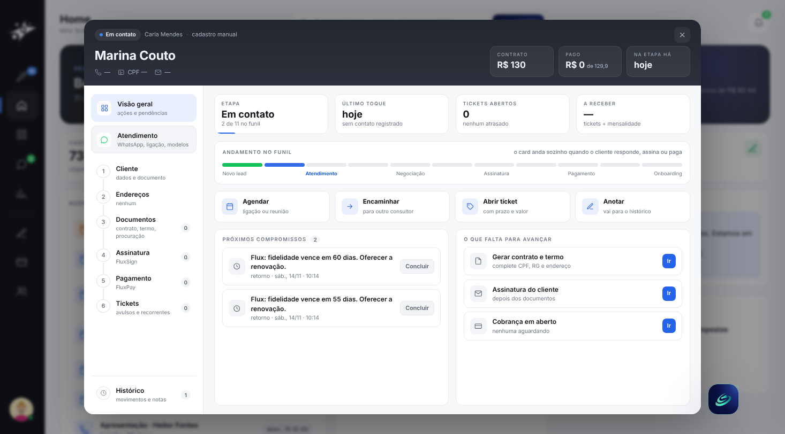
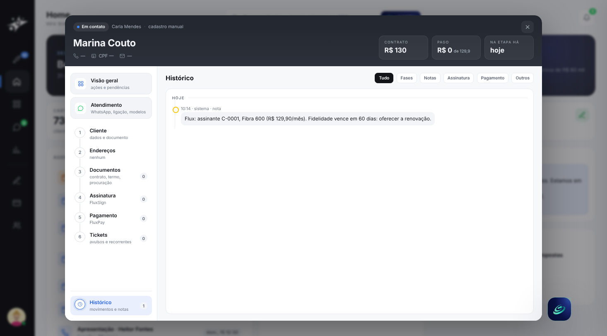

# 7 · Integração com o Flux

[voltar ao início](../../README.md)

O **Quasar** é o comercial da Demo Corporation; o **Flux** (demoflux.osmio.tech) é a operação, com instalação, cobrança recorrente e retenção. Os dois conversam por **eventos assinados**, sem banco compartilhado.

## Quasar → Flux

Uma mudança de etapa no kanban grava o evento numa fila (gatilho do banco). Um laço envia a cada 30 s, com nova tentativa dobrando o intervalo, até 8 vezes.

| Etapa no Quasar | Evento | No Flux |
|---|---|---|
| Negociação | `lead.qualificado` | abre o caso de captação |
| Assinar contrato | `proposta.aceita` | prepara o contrato |
| Pós-venda | `venda.fechada` | cria o cliente e devolve o id dele (`C-…`), que o Quasar guarda |
| Offboarding | `cliente.pediu_cancelamento` | abre a retenção |

Lead que já é cliente no Flux (renovação, ou venda já entregue) não gera captação nem venda nova lá, para não duplicar o cliente.

## Flux → Quasar

`POST /api/integracao/flux/eventos`

| Evento | No Quasar |
|---|---|
| `cobranca.recusada` | nota na ficha (ou registro na base, se o cliente não veio de uma venda do Quasar) |
| `fidelidade.vence_60d` | agendamento de renovação; para um assinante da base, cria um **lead de renovação** na carteira do consultor dele |
| `cliente.ativado` | registro |
| `cliente.cancelado` | o lead vai para Finalizado |

## Contrato

- **Assinatura:** HMAC-SHA256 do corpo, com um segredo que fica só no `.env` de cada lado e nunca passa por chat nem por código.
- **Respostas:**
  - `401`: sem assinatura ou assinatura errada;
  - `400`: fora da janela de tempo ou tipo desconhecido;
  - `404`: cliente desconhecido, com o motivo;
  - `409`: evento repetido (idempotência pelo id do evento).
- **Recusas ficam registradas.** `GET /api/integracao/flux` (gestão) mostra entregues, pendentes e recebidos com o resultado de cada um.

## A base compartilhada

Os dois sistemas carregam o mesmo **seed da Demo Corporation**: catálogo de planos, pessoas e **557 assinantes** (`C-0001…C-0557`).
- **No Quasar, a base fica fora do funil**, numa tabela própria e só de leitura. Os 557 não inflam kanban, relatórios nem carteiras.
- **Um evento de um assinante da base vira trabalho comercial.** A fidelidade vencendo, por exemplo, vira um lead de renovação com nota (plano, valor, dias que faltam) e follow-up na agenda.

